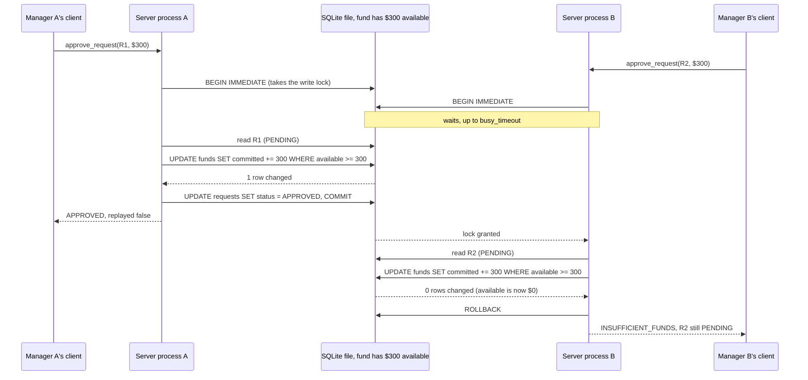

# Architecture: Emergency Assistance Funding

Version 1 (2026-11-26). Builds on [PRD.md](PRD.md) and [TECH_SPEC.md](TECH_SPEC.md).

## 1. Shape of the system

Each MCP client launches its own server process over stdio. The processes share nothing except
one SQLite file. All coordination between them is done by the database.

| Component | File | Responsibility | Knows about |
|---|---|---|---|
| Tool layer | `server.py` | Declares the 9 tools. Each tool: resolve caller → call one service function → return a model. Turns `AppError` into `ToolError`. Logs one line per call. | MCP SDK, service, identity |
| Identity | `identity.py` | Environment variable → staff row → `Caller` | db |
| Rules | `rules.py` | The role-permission table and the status-transition table | errors |
| Money | `money.py` | `"300.00"` ↔ `30000` | errors |
| Service | `service.py` | Every business operation and every SQL statement, always scoped by the caller's nonprofit | rules, money, db, errors |
| Database | `db.py`, `schema.sql` | Open a connection, run a `BEGIN IMMEDIATE` transaction | sqlite3 |
| Models | `models.py` | Pydantic output shapes | nothing |
| Errors | `errors.py` | `AppError(code, message)` | nothing |
| Seed | `seed.py` | Reset and load fixture data. Run by hand, never by the server | db |

Dependencies point one way: `server → identity, service → rules, money, db`. `rules.py` and
`money.py` import only `errors.py`, so they can be changed and tested alone.

## 2. How a tool call flows

| Step | Layer | What happens | Can fail with |
|---|---|---|---|
| 1 | SDK | Reads the JSON-RPC request from stdin, checks arguments against the tool's input schema | schema validation error |
| 2 | Tool | `caller = resolve_caller()` | `UNAUTHENTICATED` |
| 3 | Service | `rules.require(caller.role, action)` | `FORBIDDEN` |
| 4 | Service | Parse amount if there is one | `INVALID_AMOUNT` |
| 5 | Service | Open the transaction; read the record, filtered by `caller.nonprofit_id` | `NOT_FOUND` |
| 6 | Service | Check status: already done → return `replayed`; not allowed → stop | `INVALID_TRANSITION` |
| 7 | Service | Guarded update of the fund, then update of the request; commit | `INSUFFICIENT_FUNDS` |
| 8 | Tool | Build the output model, log the outcome to stderr | – |
| 9 | SDK | Validates the result against the output schema, writes the response to stdout | – |

Read tools stop after step 5. Any failure from step 5 onward rolls the transaction back.

## 3. Two approvals at the same time

Two program managers, each with their own client and server process, approve different requests
against a fund that only has room for one. This is the case from PRD AC-08.

| Layer | What it does | What breaks without it |
|---|---|---|
| `BEGIN IMMEDIATE` | One writer at a time across all processes. The second waits and then reads the first one's committed balance. | Both read "$300 available" and both approve. |
| Guarded `UPDATE` on the fund | The balance check and the change are one statement; zero rows changed means refuse. | A check in Python followed by a separate write could be separated by another writer. |
| `WHERE status = 'PENDING'` on the request | The same request cannot be approved twice, even if two processes pick it at once. | Double reservation for one request. |
| `CHECK` constraints on `funds` | The database refuses any row where `committed + paid > allocation` or a counter is negative. | A future code bug could overspend silently. |

The same mechanism covers the same request approved from two processes (second one sees
`APPROVED` and returns `replayed`) and the same payment recorded twice.

How this is verified: a test starts real server processes with `Client(StdioServerParameters)`,
fires the approvals together, and asserts the exact outcome of AC-08. The guard is then broken on
purpose once to confirm the test fails; the result is recorded as it happened.

## 4. Implementation tasks

Each task is one commit. A task is done only when its gate passes. Docs for tasks 1–3 are
committed and tagged `spec-v1` before task 4.

| # | Task | Depends on | Requirements | Gate |
|---|---|---|---|---|
| 4 | Scaffold: `pyproject.toml`, `uv.lock`, package skeleton, pytest `req` marker | 3 | NFR-03 | `uv sync` and `uv run pytest` run clean |
| 5 | `money.py`, `rules.py`, `errors.py` + unit tests | 4 | BR-02, BR-10, SEC-04, SEC-05 | Unit tests green |
| 6 | `schema.sql`, `db.py`, `seed.py` | 4 | FR-11, FR-12, BR-08 (constraints) | Reset twice gives identical data; a direct overspending `UPDATE` is refused by the database |
| 7 | `identity.py` | 6 | SEC-01, SEC-02, SEC-03 | Missing and unknown identity tests green |
| 8 | Service reads | 5, 7 | FR-01, FR-02, FR-07, FR-08, FR-09, SEC-06 | Cross-nonprofit reads return `NOT_FOUND` or nothing |
| 9 | Service writes | 8 | FR-03 to FR-06, BR-01 to BR-09, BR-12 to BR-15, IDM-01 to IDM-06 | AC-01 to AC-07 and AC-09 to AC-18 pass as service tests |
| 10 | `server.py` + in-memory MCP tests | 9 | FR-10, SEC-07, SEC-08, NFR-01, NFR-02 | Schemas published; SDK assumptions S1–S4 confirmed or revised |
| 11 | Stdio end-to-end test and multi-process contention test | 10 | BR-11, AC-08, AC-24, AC-27 | Green on repeated runs; deliberate break makes it fail |
| 12 | Random-sequence invariant test | 9 | BR-08, BR-12, AC-26 | Green for every seed |
| 13 | `scripts/trace.py`, `docs/TRACEABILITY.md` | 11, 12 | all | Exits 0: every requirement has a test |
| 14 | `scripts/demo.py`, `README.md` | 10 | AC-27, NFR-03 | Demo runs clean from a fresh reset |
| 15 | Final writeup, close logs | all | – | Real command output pasted, including failures or unrun checks |

## 5. Working with an AI coding agent

| Practice | How it is applied here |
|---|---|
| Scope one task at a time | The agent gets one row of the table above, the spec sections it implements and the requirement IDs. Nothing else is in scope. |
| Spec is the source of behaviour | If the spec does not say what should happen, the agent stops and asks instead of inventing it. The answer goes into the spec and the revision log. |
| Define done before starting | Each task has a gate that can be run, not an opinion. |
| Tests carry requirement IDs | Every test is tagged, and `scripts/trace.py` fails the build if a requirement has no test. |
| Review every diff | I read each change before it is committed and must be able to explain it. Checklist: no identity-like tool argument; every query on an owned table filters by nonprofit; money is integers only; permissions and transitions come only from `rules.py`; no new dependency; nothing from the out-of-scope list. |
| Check claims independently | SDK behaviour is confirmed by running it, not by the agent's recall (docs were read first; section 12 of the tech spec lists what still needs a test). The concurrency test is proven by breaking the guard and watching it fail. |
| Keep an honest record | `AI_LOG.md` records prompts, suggestions, evidence and real corrections. `REVISIONS.md` records spec changes and why. |
